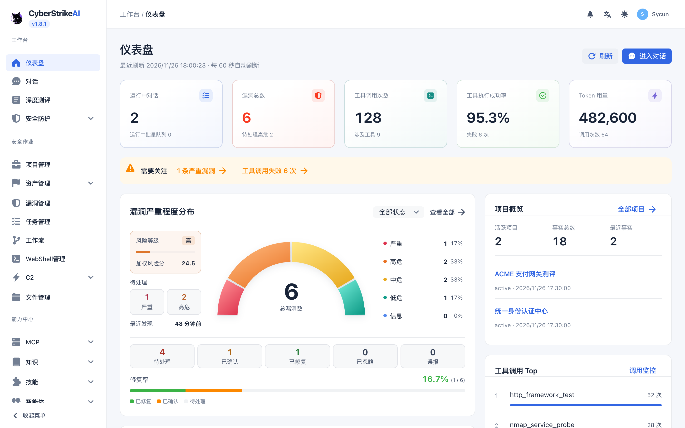
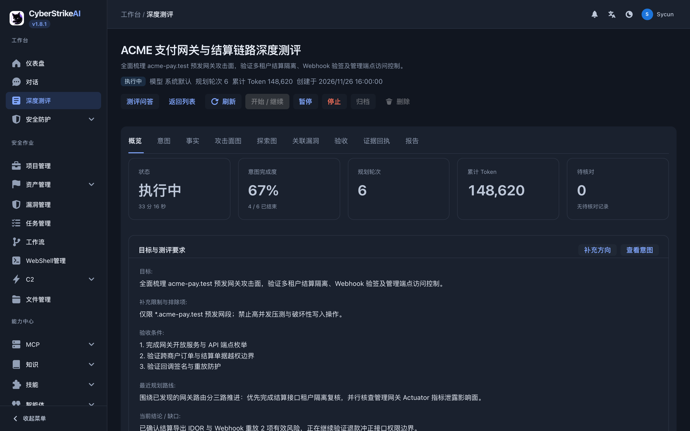
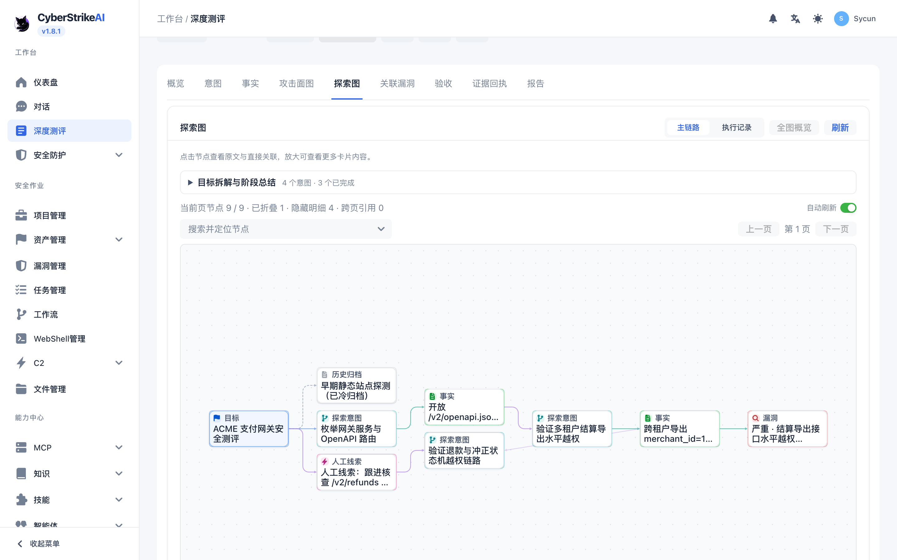
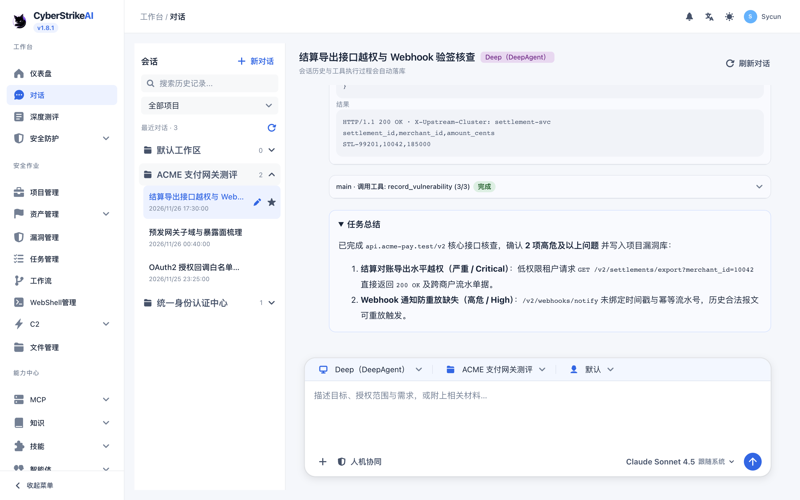
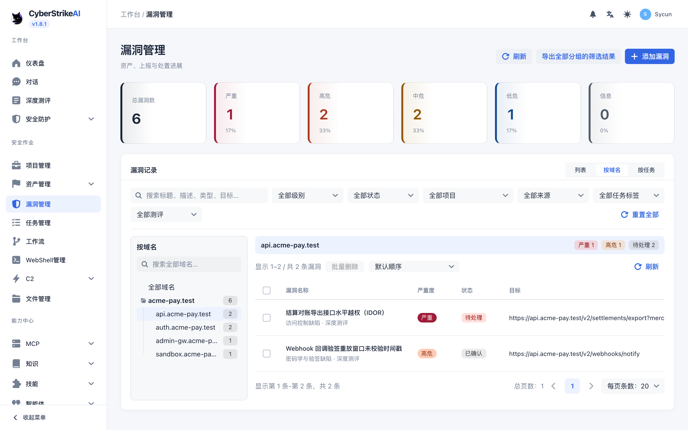
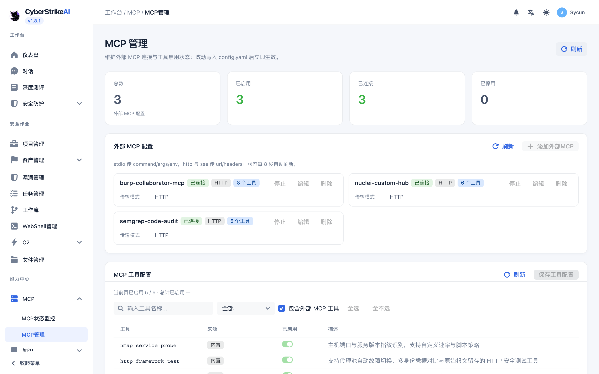

<div align="center">
  
  <h1>CyberStrikeAI</h1>
  <p><strong>Describe goals or tasks, run tool-calling security agents, and record verifiable execution evidence.</strong></p>
  <p><a href="README_CN.md">中文</a> · <strong>English</strong></p>
  <p>
    <a href="https://github.com/Sycun/CyberStrikeAI/actions/workflows/pi-runtime.yml"></a>
    <a href="https://github.com/Sycun/CyberStrikeAI/actions/workflows/deep-assessments.yml"></a>
    <a href="https://github.com/Sycun/CyberStrikeAI/actions/workflows/frontend-build.yml"></a>
    <a href="https://github.com/Sycun/CyberStrikeAI/actions/workflows/self-update.yml"></a>
  </p>
</div>

CyberStrikeAI is an open-source cybersecurity agent workbench built with **Go + Pi** (Go backend + React / Semi Design frontend). It unifies interactive security chat, goal-driven **Deep Assessments**, and list-driven **Batch Tasks**, enabling security agents to orchestrate tools and record structured execution evidence.

> This repository ([Sycun/CyberStrikeAI](https://github.com/Sycun/CyberStrikeAI)) is forked from the original open-source [AIPentest/CyberStrikeAI](https://github.com/AIPentest/CyberStrikeAI) repository with its full commit history, copyright notices, and [Apache-2.0 License](LICENSE) preserved. Following the upstream project's transition to closed source, this repository is independently maintained and developed as an open-source branch by **[Sycun](https://github.com/Sycun)**, former core maintainer of the official project.

[Key highlights](#highlights) · [Preview](#screenshots) · [Quick start](#quick-start) · [Execution modes](#delegation) · [Capabilities](#capabilities) · [Architecture](#architecture) · [Documentation](#documentation) · [Feedback](#contributing)

<a id="highlights"></a>

## Key highlights

- **Native Pi 1.5.2 agent runtime**: Powered by native Pi session persistence, automatic context compaction, live mid-run steering (**Interrupt & continue**), and configurable reasoning-effort controls, with legacy Eino engine dependencies completely removed.
- **Goal-driven Deep Assessments workbench**: Long-running autonomous assessments backed by a shared project **Attack-Surface Graph**, hot/cold archived **Exploration Graph**, prioritized **Intent Queue**, and receipt-backed **Facts & Acceptance Evidence Matrix**.
- **React 19 + Semi Design workbench**: Modern single-page interface featuring unified detail drawers, project-grouped conversations, compact model/role pickers, domain/host/task vulnerability views, and **one-click vulnerability retesting**.
- **Multi-gateway compatibility & adaptive context**: Supports custom per-channel auth headers (same-origin guarded for third-party gateways), automatic runtime context-window probing, `local_auto` profiles for local inference servers (oMLX, Ollama, etc.), DeepSeek economy profiles, and dedicated HITL review model testing.
- **Isolated HTTP proxy pool & self-hosted operations**: Provides an [HTTP testing proxy pool with failover](docs/en-US/http-proxy-pool.md) isolated from model API traffic, supervisor-free **One-Click Update** preserving self-signed TLS certs and active sessions, plus previewable **Storage Cleanup**.

<a id="screenshots"></a>

## Workbench preview

| Dashboard (Risk distribution & live metrics) | Deep Assessments (Dark theme · Goals & progress) |
| :---: | :---: |
|  |  |

| Deep Assessments · Exploration Graph (Intents, facts, findings & archive) | Chat Console (Project groups, tool receipts & summary) |
| :---: | :---: |
|  |  |

| Vulnerability Management (Domain/host tree & severity overview) | MCP & Tool Management (External MCP status & built-in tools) |
| :---: | :---: |
|  |  |

<a id="quick-start"></a>

## Quick start

### 1. Prepare the environment

| Dependency | Requirement | Purpose |
| --- | --- | --- |
| Go | 1.25+; see [go.mod](go.mod) | Build the backend server and runtime builder |
| Node.js and npm | Node.js 22.19+ | Build and run the Pi worker (and optional frontend rebuilds) |
| Python | 3.10+, with `venv` support | Launcher and Python tool dependencies |
| Git | Available on `PATH` | Clone source and run Web one-click updates |

You also need a model channel that supports tool calling, plus the local security tools or external MCP servers required by your tasks. The repository includes tool recipes, **not preinstalled third-party security binaries**. By default, `run.sh` configures temporary Go and PyPI mirrors for faster setup; set `GOPROXY` and `PIP_INDEX_URL` in your environment to override them.

### 2. Clone and start

Run the following commands in Bash on macOS or Linux:

```bash
git clone --branch main https://github.com/Sycun/CyberStrikeAI.git
cd CyberStrikeAI
cp config.example.yaml config.yaml
```

For local trials, set `server.host` in `config.yaml` to `127.0.0.1`, then start the server:

```bash
bash run.sh --http
```

The script builds the Pi worker, creates a Python virtual environment, installs dependencies, and compiles the Go server (prebuilt frontend assets are already included under `web/static/app/`). Open [http://127.0.0.1:8080/](http://127.0.0.1:8080/) by default, or check your terminal output for the active port.

Without `--http`, `run.sh` starts with HTTPS + HTTP/2 and generates a reusable local self-signed certificate when none is configured. For shared team deployments, see the [deployment guide](docs/en-US/deployment.md) for bind addresses, TLS certificates, and access controls.

### 3. Complete the initial setup

1. Sign in with the initial `admin` password printed under `ADMIN SETUP REQUIRED` in the terminal, then change it.
2. Go to **System settings → Basic → AI channel config**, enter your provider, Base URL, API key, and model, then save it as the default channel (values in `config.example.yaml` are placeholders).
3. Install the local tools needed for your engagement or connect external MCP servers, and verify each tool before assigning it to an agent role.
4. For multi-user deployments, create separate member accounts, roles, and project scopes under **Platform Access → Add Member**.

Use [config.example.yaml](config.example.yaml) as the full reference. See [configuration](docs/en-US/configuration.md) and [configuration profiles](docs/en-US/configuration-profiles.md) for model channels, local models, and context sizing.

<details>
<summary><strong>Manual build and frontend customization</strong></summary>

After preparing `config.yaml`, you can build the Pi worker and Go server step by step:

```bash
bash scripts/build-pi-runtime.sh
go build -o cyberstrike-ai ./cmd/server
./cyberstrike-ai -config config.yaml --http
```

If you modify frontend source files under `web/frontend/`, rebuild the static bundle before starting the server:

```bash
cd web/frontend && npm ci && npm run build
```

Deployments require the runtime directory, `web/static/`, and a matching Pi worker bundle (or a fresh build on the target host); copying the Go binary alone is not sufficient to run agents. Prepare Python tool dependencies separately. See the [Pi runtime guide](docs/en-US/pi-runtime.md).

</details>

<a id="delegation"></a>

## Execution modes

CyberStrikeAI provides three complementary ways to run security work over a shared project asset library, tool permissions, and vulnerability records:

- **Chat**: Interactive investigation and ad-hoc tool execution across single-agent, Deep, Plan-Execute, and Supervisor modes, with project-grouped conversations and live mid-run steering via **Interrupt & continue**.
- **Deep Assessments**: Goal-driven persistent assessment workbench powered by native Pi sessions. Maintains attack-surface graphs, exploration graphs, prioritized intent queues, in-task operator Q&A, and receipt-backed acceptance criteria across pause/resume cycles. See the [deep assessments guide (zh-CN)](docs/zh-CN/deep-assessments.md).
- **Tasks (Task Management)**: Queue-based batch execution for explicit task lists. Open **Tasks → New task** (`Task Management`), enter one task per line, and configure project scope, role, agent mode, tool approval, concurrency, and optional Cron schedules. Inspect per-subtask results and conversations, or pause, resume, and edit subtasks from the queue detail view. See [batch task management (zh-CN)](docs/zh-CN/task-management.md).

<a id="capabilities"></a>

## Capabilities

| Capability | What it provides | Details |
| --- | --- | --- |
| Pi agent orchestration | Single-agent, Deep, Plan-Execute, and Supervisor modes with live steering and reasoning controls | [Agents and roles](docs/en-US/agent-and-role-guide.md) |
| Deep assessments | Goal-driven planning, shared attack-surface graph, hot/cold exploration graph, intent queues, and acceptance matrix | [Deep assessments (zh-CN)](docs/zh-CN/deep-assessments.md) |
| Batch task queues | Concurrent task lists, Cron schedules, pause/resume, and subtask conversation logs | [Task management (zh-CN)](docs/zh-CN/task-management.md) |
| Tools, skills, and proxy pool | YAML tool recipes, MCP connections, on-demand skills, and isolated HTTP egress proxy pool | [Tools](tools/README_EN.md) · [Skills](skills/README.md) · [Proxy pool](docs/en-US/http-proxy-pool.md) |
| Visual workflows | Compose agent, tool, conditional, and human-approval nodes | [Workflows](docs/en-US/workflow-graph.md) |
| Knowledge, evidence, and reports | RAG retrieval, project facts, raw tool receipts, attack-chain analysis, and Word / Markdown reports | [Knowledge base](docs/en-US/knowledge-base.md) · [Reports](docs/en-US/word-reports.md) |
| Project & vulnerability workspace | Project-scoped asset library, domain/host/task vulnerability views, and one-click retesting | [Asset management](docs/en-US/asset-management.md) |
| Human oversight & governance | RBAC, human-in-the-loop (HITL) approvals, call guards, audit logs, and token monitoring | [Security model](docs/en-US/security-model.md) · [HITL](docs/en-US/hitl-best-practices.md) · [Token usage](docs/en-US/token-usage-monitoring.md) |
| Integrations | Burp Suite extension, browser DevTools extension, chat bots, and MCP federation | [Plugins](#integrations) · [Bots](docs/en-US/robot.md) · [MCP](docs/en-US/mcp-federation.md) |

Specialized operations also include [WebShell management](docs/en-US/webshell.md) and [C2](docs/en-US/c2.md). Enable only the capabilities required for your authorized scope; a bundled tool recipe does not imply the underlying binary is installed or validated in your environment.

<a id="architecture"></a>

## Architecture

| Component | Responsibility |
| --- | --- |
| **Go server and schedulers** | HTTP/SSE APIs, deep-assessment and batch-queue scheduling, tool governance, storage cleanup, and evidence persistence |
| **Pi runtime** | **Pi 1.5.2** model interaction, agent tool loops, native session persistence, compaction, steering, and tool discovery |
| **Tool gateway** | Dispatches local tools and MCP calls under role boundaries, permissions, HITL approvals, and output/timeout guards |
| **SQLite and Pi sessions** | Business state, graph nodes, and raw tool receipts in SQLite; model transcripts and compaction entries in Pi sessions |
| **Web workbench** | React 19 + Semi Design + Cytoscape frontend unifying chat, assessment graphs, task traces, and project assets |

<a id="integrations"></a>

## Browser and proxy plugins

| Integration | Usage | Documentation and package |
| --- | --- | --- |
| Burp Suite | Send selected HTTP requests to CyberStrikeAI for analysis | [Setup](plugins/burp-suite/cyberstrikeai-burp-extension/README.md) · [JAR](plugins/burp-suite/cyberstrikeai-burp-extension/dist/cyberstrikeai-burp-extension.jar) |
| Chrome / Edge | Capture and forward requests from the CyberStrikeAI DevTools panel | [Setup](plugins/browser-extension/cyberstrikeai-browser-extension/README.md) · [ZIP](plugins/browser-extension/cyberstrikeai-browser-extension/dist/cyberstrikeai-browser-extension.zip) |

## Updates and version migration

Fresh installations using [config.example.yaml](config.example.yaml) point updates to this repository by default:

```yaml
update:
  repo: https://github.com/Sycun/CyberStrikeAI
```

When migrating an older installation, ensure `update.repo` is set to `https://github.com/Sycun/CyberStrikeAI` in `config.yaml` or under **System settings → One-Click Update** (leaving `update.repo` empty still points to the historical upstream URL, which no longer publishes open-source updates). One-click update pulls the latest source, rebuilds a matching Pi worker and server binary, and preserves existing self-signed TLS certificates and active sessions; see [deployment](docs/en-US/deployment.md) for details.

Before upgrading from an older Eino-based release, back up your configuration and database and finish or export active workflow runs: **legacy Eino binary workflow checkpoints cannot be resumed in this version**. Historical records, configuration keys, and compatibility routes remain readable, with no legacy-engine fallback switch. See the [Pi runtime and migration guide](docs/en-US/pi-runtime.md).

## Validation and scope

Continuous integration covers Go backend tests, Pi runtime protocol checks, frontend builds, process isolation, HTTP proxy pool tests, and isolated regressions for deep assessments and batch queues; check [GitHub Actions](https://github.com/Sycun/CyberStrikeAI/actions) for current status. Automated checks do not replace live evaluation—model compatibility, token cost, and effectiveness on real targets depend on your configured model channel and environment.

<a id="documentation"></a>

## Documentation

| What you want to do | Start here |
| --- | --- |
| Deploy and configure models | [Deployment](docs/en-US/deployment.md) · [Configuration](docs/en-US/configuration.md) · [Config profiles](docs/en-US/configuration-profiles.md) · [Troubleshooting](docs/en-US/troubleshooting.md) |
| Run assessments and batch queues | [Deep assessments (zh-CN)](docs/zh-CN/deep-assessments.md) · [Task management (zh-CN)](docs/zh-CN/task-management.md) |
| Customize agents, tools, and proxies | [Pi runtime](docs/en-US/pi-runtime.md) · [Agents and roles](docs/en-US/agent-and-role-guide.md) · [Tool recipes](tools/README_EN.md) · [HTTP proxy pool](docs/en-US/http-proxy-pool.md) |
| Integrate external systems | [API reference](docs/en-US/api-reference.md) · [API examples](docs/en-US/api-recipes.md) · [MCP federation](docs/en-US/mcp-federation.md) |
| Operate a team service | [Security hardening](docs/en-US/security-hardening.md) · [Tool governance](docs/en-US/tool-execution-governance.md) · [Runbooks](docs/en-US/runbooks.md) |
| Contribute and explore the repo | [Developer guide](docs/en-US/developer-guide.md) · [Testing](docs/en-US/testing.md) · [Repository guide](docs/REPOSITORY_GUIDE.md) |

Browse all topics in the [English documentation](docs/en-US/README.md) or the [bilingual index](docs/README.md).

<a id="contributing"></a>

## Feedback and contributions

As an independently maintained open-source branch, community bug reports, feature requests, and pull requests (including tool recipes, UX refinements, and regression tests) are welcome in [Issues](https://github.com/Sycun/CyberStrikeAI/issues) and Pull Requests. When reporting issues, please include the commit hash, OS, model protocol/channel type, reproduction steps, and redacted logs—never upload live API keys, credentials, or sensitive engagement data.

Thanks to the original authors and past contributors of the earlier open-source [AIPentest/CyberStrikeAI](https://github.com/AIPentest/CyberStrikeAI) project, as well as the Pi, MCP, and broader open-source communities.

## License and intended use

Licensed under the [Apache License 2.0](LICENSE) with the original commit history and copyright notices preserved; third-party components retain their respective licenses and notices. Use this software only on systems you own or have explicit written authorization to test, in compliance with your agreed scope and applicable law. See [SECURITY.md](SECURITY.md) for vulnerability reporting.
