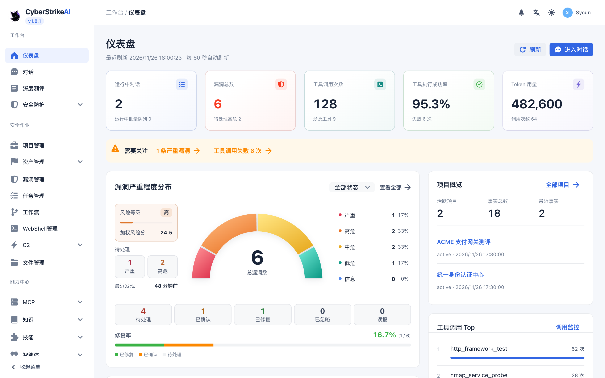
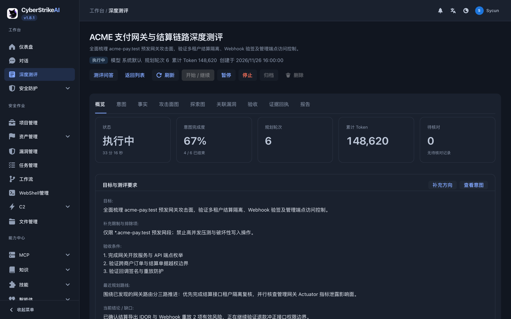
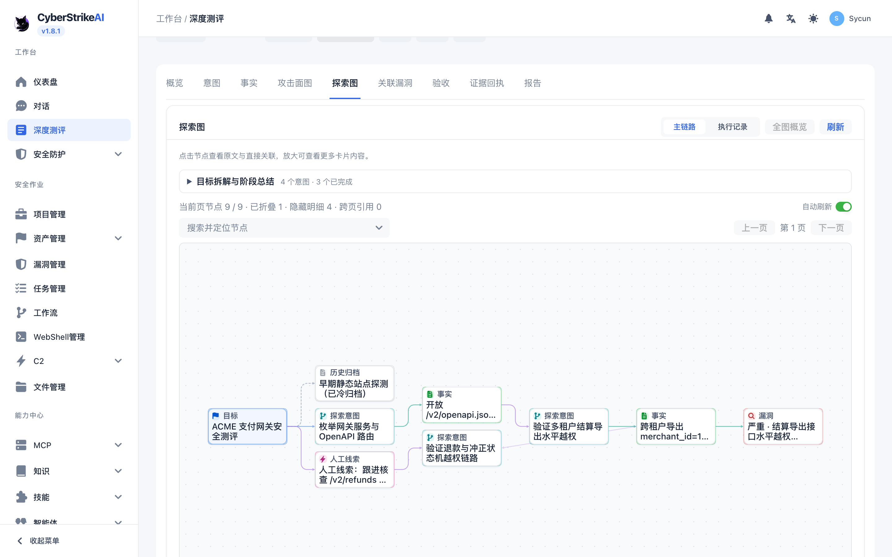
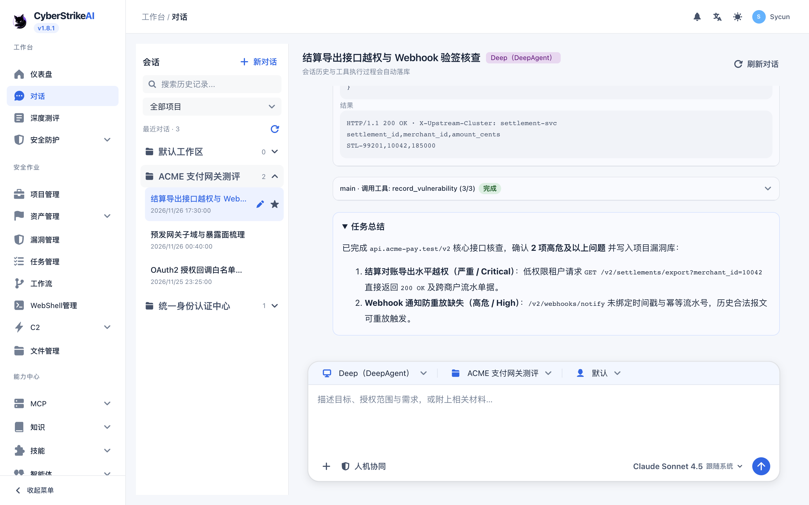
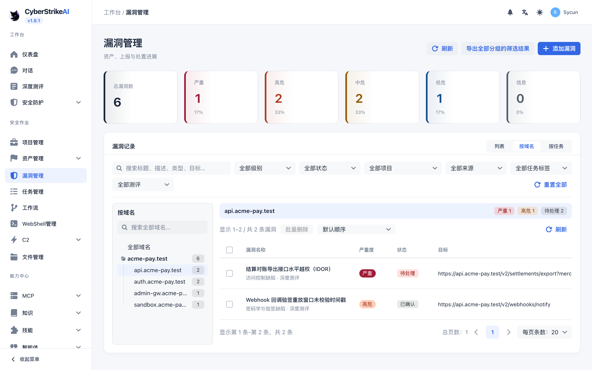
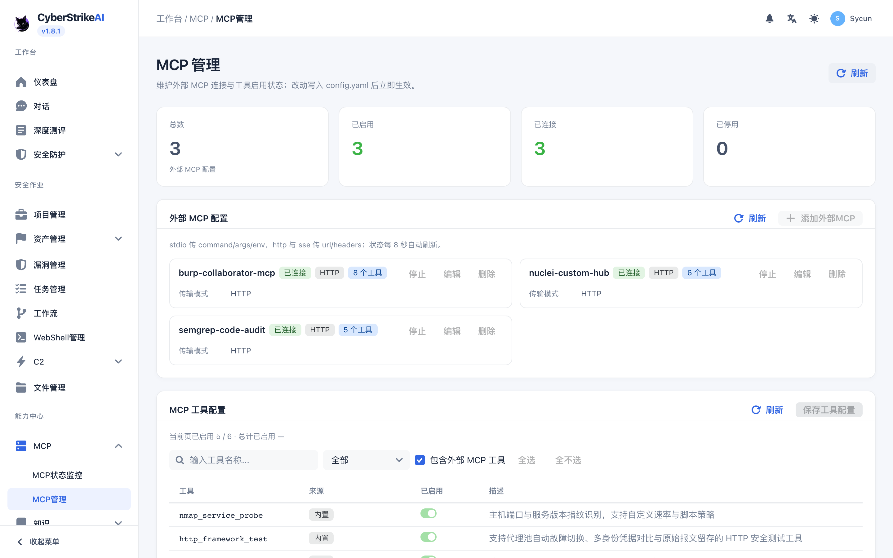

<div align="center">
  
  <h1>CyberStrikeAI</h1>
  <p><strong>描述目标或任务，驱动安全智能体调用工具并沉淀可核查的执行证据。</strong></p>
  <p><strong>中文</strong> · <a href="README.md">English</a></p>
  <p>
    <a href="https://github.com/Sycun/CyberStrikeAI/actions/workflows/pi-runtime.yml"></a>
    <a href="https://github.com/Sycun/CyberStrikeAI/actions/workflows/deep-assessments.yml"></a>
    <a href="https://github.com/Sycun/CyberStrikeAI/actions/workflows/frontend-build.yml"></a>
    <a href="https://github.com/Sycun/CyberStrikeAI/actions/workflows/self-update.yml"></a>
  </p>
</div>

CyberStrikeAI 是基于 **Go + Pi** 构建的开源网络安全智能体工作台（Go 后端 + React / Semi Design 前端），统一承载交互式安全对话、目标驱动的**深度测评**与清单驱动的**批量任务**，由智能体编排调用安全工具并沉淀结构化执行证据。

> 本仓库（[Sycun/CyberStrikeAI](https://github.com/Sycun/CyberStrikeAI)）Fork 自原开源仓库 [AIPentest/CyberStrikeAI](https://github.com/AIPentest/CyberStrikeAI)，完整保留原始提交历史、版权声明与 [Apache-2.0 许可证](LICENSE)。在原官方项目转向闭源后，本仓库由原官方核心维护者 **[Sycun](https://github.com/Sycun)** 作为独立开源分支继续维护与演进。

[核心特性](#highlights) · [界面预览](#screenshots) · [快速上手](#quick-start) · [任务与测评模式](#delegation) · [主要能力](#capabilities) · [架构](#architecture) · [文档](#documentation) · [反馈与贡献](#contributing)

<a id="highlights"></a>

## 核心特性

- **Pi 1.5.2 原生智能体运行时**：全面采用原生 Pi 会话持久化、自动上下文压缩（Compaction）、执行中实时「中断并继续（Steering）」以及推理强度（Reasoning Effort）档位调节，已彻底移除早期 Eino 引擎依赖。
- **目标驱动的「深度测评」持久工作台**：围绕测评目标与验收条件长周期推进，内置项目级共享**攻击面图**、支持冷热分支归档的**探索图谱**、优先级**意图队列**，以及强制绑定真实工具回执的**事实记录与验收证据矩阵**。
- **React 19 + Semi Design 统一工作台**：采用现代化单页架构，支持抽屉式详情查阅、按项目分组管理对话、紧凑模型与角色切换，以及按域名、主机、任务多维聚合的漏洞管理与**一键复测**。
- **多网关兼容与上下文自适应**：支持渠道自定义鉴权请求头（适配各类第三方聚合网关，限制同源重定向防泄露）、运行时上下文窗口自动探测、本地推理服务（oMLX / Ollama 等）`local_auto` 画像、DeepSeek 经济上下文画像及独立 HITL 审计模型配置。
- **独立出站代理池与自托管运维**：提供与模型 API 流量隔离的 [HTTP 测试代理池与故障切换](docs/zh-CN/http-proxy-pool.md)；内置保留自签证书与登录态的 Web 端**一键自更新**，以及可预览的运行空间**存储清理**。

<a id="screenshots"></a>

## 界面预览

| 系统仪表盘（风险分布与运行态概览） | 深度测评工作台（深色主题 · 目标与进度） |
| :---: | :---: |
|  |  |

| 深度测评 · 探索图谱（意图、事实、漏洞与冷归档） | 对话控制台（项目分组、工具回执与任务总结） |
| :---: | :---: |
|  |  |

| 漏洞管理（按域名/主机树状聚合与严重度统计） | MCP 与工具管理（外部 MCP 连接与内置工具配置） |
| :---: | :---: |
|  |  |

<a id="quick-start"></a>

## 快速上手

### 1. 准备环境

| 依赖 | 要求 | 用途 |
| --- | --- | --- |
| Go | 1.25+，以 [go.mod](go.mod) 为准 | 编译后端服务与运行时构建器 |
| Node.js 与 npm | Node.js 22.19+ | 构建与运行 Pi Worker（及可选前端二次构建） |
| Python | 3.10+，支持 `venv` | 启动脚本及 Python 工具依赖 |
| Git | 已加入 `PATH` | 克隆源码与 Web 端一键更新 |

运行前还需准备支持工具调用（Tool Calling）的模型渠道，以及任务实际所需的本地安全工具或外部 MCP 服务。仓库内置工具配方，但**不会自动安装所有第三方安全工具**。`run.sh` 默认使用国内临时镜像加速 Go 与 pip 依赖下载，也可通过环境变量 `GOPROXY`、`PIP_INDEX_URL` 自定义。

### 2. 获取源码并启动

以下命令适用于 macOS / Linux 的 Bash 环境：

```bash
git clone --branch main https://github.com/Sycun/CyberStrikeAI.git
cd CyberStrikeAI
cp config.example.yaml config.yaml
```

本机试用建议先将 `config.yaml` 中的 `server.host` 改为 `127.0.0.1`，然后启动服务：

```bash
bash run.sh --http
```

脚本会自动构建 Pi Worker、创建 Python 虚拟环境、安装依赖并编译启动服务（前端静态产物已预构建在 `web/static/app/` 中，开箱即用）。默认监听 [http://127.0.0.1:8080/](http://127.0.0.1:8080/)，实际端口以配置和终端输出为准。

不带 `--http` 时，`run.sh` 默认启用 HTTPS + HTTP/2（未配置证书时自动生成并复用本地自签证书）。团队共享部署的监听地址、TLS 证书与访问控制请参考[部署指南](docs/zh-CN/deployment.md)。

### 3. 完成首次配置

1. 使用终端 `ADMIN SETUP REQUIRED` 输出的初始 `admin` 密码登录，并按提示修改密码。
2. 在 **系统设置 → 基本设置 → AI 通道配置** 中填写提供商、Base URL、API Key 和模型，保存后设为默认通道（示例配置中的凭据仅为占位符）。
3. 按需安装本地安全工具或接入外部 MCP 服务，确认工具可用后再分配给对应角色或智能体。
4. 多人协作时，可在 **平台权限 → 添加成员** 中为团队成员分配独立账号、角色与数据范围。

完整配置项以 [config.example.yaml](config.example.yaml) 为准；模型通道、本地模型与上下文策略详见[配置参考](docs/zh-CN/configuration.md)与[配置画像](docs/zh-CN/configuration-profiles.md)。

<details>
<summary><strong>手动构建与前端二次开发</strong></summary>

完成 `config.yaml` 配置后，可分步构建 Pi Worker 与 Go 服务：

```bash
bash scripts/build-pi-runtime.sh
go build -o cyberstrike-ai ./cmd/server
./cyberstrike-ai -config config.yaml --http
```

若修改了 `web/frontend/` 下的前端源码，重新构建静态产物后再启动服务即可：

```bash
cd web/frontend && npm ci && npm run build
```

部署时需同时保留运行时目录、`web/static/` 与匹配的 Pi Worker 构建产物（或在目标机器重新执行构建），仅复制单个 Go 二进制无法运行智能体；Python 工具依赖需另行准备。详见 [Pi 运行时说明](docs/zh-CN/pi-runtime.md)。

</details>

<a id="delegation"></a>

## 任务与测评模式

平台提供三种互补的执行入口，共享同一套项目资产库、工具权限与漏洞记录：

- **对话（Chat）**：面向交互式研判与即时操作，支持单智能体、Deep、Plan-Execute、Supervisor 模式，支持按项目分组管理会话，并可在执行中通过「中断并继续」实时补充人工指令。
- **深度测评（Deep Assessments）**：面向目标驱动的持续安全测评。围绕测评目标与验收条件，基于 Pi 原生会话维护攻击面图、探索图、优先级意图队列与原始执行回执，支持长周期暂停、恢复、任务内追问与验收证据核对。详见[深度测评说明](docs/zh-CN/deep-assessments.md)。
- **任务管理（Batch Tasks）**：面向清单驱动的批量队列执行。在 **任务管理 → 新建任务** 中每行填写一项任务，配置项目、角色、代理模式、工具审批、并发数与可选 Cron 定时规则，在队列详情中查看子任务结果与执行会话，并按状态暂停、继续或编辑子任务。详见[批量任务管理](docs/zh-CN/task-management.md)。

<a id="capabilities"></a>

## 主要能力

| 能力 | 功能概述 | 参考文档 |
| --- | --- | --- |
| Pi 智能体编排 | 单智能体、Deep、Plan-Execute、Supervisor 多模式执行、中途引导与推理档位控制 | [智能体与角色](docs/zh-CN/agent-and-role-guide.md) |
| 深度测评 | 目标驱动规划、共享攻击面图、探索图冷热记忆、意图队列与验收证据矩阵 | [深度测评](docs/zh-CN/deep-assessments.md) |
| 批量任务队列 | 清单并发执行、Cron 定时调度、暂停/继续与子任务会话追溯 | [批量任务管理](docs/zh-CN/task-management.md) |
| 工具、Skills 与代理池 | YAML 工具配方、外部 MCP 接入、按需技能加载与独立 HTTP 出站代理池 | [工具](tools/README.md) · [Skills](skills/README.md) · [代理池](docs/zh-CN/http-proxy-pool.md) |
| 可视化工作流 | 编排智能体、工具、条件分支与人工审批节点 | [工作流](docs/zh-CN/workflow-graph.md) |
| 知识、证据与报告 | RAG 检索、项目事实沉淀、原始工具回执、攻击链分析与 Word / Markdown 报告导出 | [知识库](docs/zh-CN/knowledge-base.md) · [报告导出](docs/zh-CN/word-reports.md) |
| 项目与漏洞工作台 | 项目级资产库、域名/主机/任务多维漏洞视图、详情抽屉一键复测 | [资产管理](docs/zh-CN/asset-management.md) |
| 人工监督与治理 | RBAC 权限控制、高风险工具审批（HITL）、调用拦截、操作审计与 Token 监控 | [安全模型](docs/zh-CN/security-model.md) · [HITL](docs/zh-CN/hitl-best-practices.md) · [Token 监控](docs/zh-CN/token-usage-monitoring.md) |
| 外部生态集成 | Burp Suite 插件、浏览器 DevTools 扩展、IM 机器人与外部 MCP 联邦 | [插件](#integrations) · [机器人](docs/zh-CN/robot.md) · [MCP](docs/zh-CN/mcp-federation.md) |

专项能力还包括 [WebShell 管理](docs/zh-CN/webshell.md) 与 [C2 协同](docs/zh-CN/c2.md)。请按授权任务范围启用所需模块；仓库包含工具配方不代表对应二进制已在本地安装或完成环境校验。

<a id="architecture"></a>

## 架构概览

| 组件 | 核心职责 |
| --- | --- |
| **Go 服务与调度引擎** | 承载 HTTP/SSE 接口、深度测评与批量队列调度、工具执行管控、存储清理及证据落盘 |
| **Pi 运行时** | 基于 **Pi 1.5.2** 处理模型交互、工具调用循环、原生会话持久化、上下文压缩与中途引导（Steering） |
| **工具网关** | 统一分发本地工具与 MCP 调用，执行角色边界、权限校验、人工审批与超时/输出截断治理 |
| **SQLite 与 Pi 会话存储** | SQLite 保存业务状态、图谱节点与执行回执；Pi 会话记录模型上下文与压缩摘要 |
| **Web 工作台** | 基于 React 19 + Semi Design + Cytoscape 构建的前端界面，统一呈现对话、测评图谱、任务轨迹与项目资产 |

<a id="integrations"></a>

## 浏览器与抓包插件

| 集成组件 | 用途 | 文档与构建包 |
| --- | --- | --- |
| Burp Suite 插件 | 将选中的 HTTP 请求一键发送至 CyberStrikeAI 进行安全分析 | [安装说明](plugins/burp-suite/cyberstrikeai-burp-extension/README.zh-CN.md) · [JAR](plugins/burp-suite/cyberstrikeai-burp-extension/dist/cyberstrikeai-burp-extension.jar) |
| Chrome / Edge 扩展 | 在浏览器 DevTools 的 CyberStrikeAI 面板捕获并提交请求 | [安装说明](plugins/browser-extension/cyberstrikeai-browser-extension/README.zh-CN.md) · [ZIP](plugins/browser-extension/cyberstrikeai-browser-extension/dist/cyberstrikeai-browser-extension.zip) |

## 更新与版本迁移

新安装的 [config.example.yaml](config.example.yaml) 默认将更新源指向本仓库：

```yaml
update:
  repo: https://github.com/Sycun/CyberStrikeAI
```

若从旧版安装迁移而来，请在 `config.yaml` 或 **系统设置 → 一键更新** 中确认更新源已设为 `https://github.com/Sycun/CyberStrikeAI`（`update.repo` 留空仍指向已停止开源更新的旧仓库地址）。一键更新会自动拉取源码、重新构建匹配的 Pi Worker 与服务二进制，并保留现有自签 TLS 证书与登录会话；详细步骤见[部署指南](docs/zh-CN/deployment.md)。

若从早期 Eino 版本升级，请先备份运行配置与数据库，并结束或导出旧工作流任务：**旧版 Eino 二进制工作流检查点无法在当前版本直接续跑**。历史数据记录、常用配置键与兼容路由仍保持可读，但不提供旧引擎切换开关。详见 [Pi 运行时与迁移说明](docs/zh-CN/pi-runtime.md)。

## 验证与质量边界

持续集成覆盖 Go 后端测试、Pi 运行时协议校验、前端构建、进程隔离、代理池以及深度测评与批量队列的隔离回归检查，最新状态见 [GitHub Actions](https://github.com/Sycun/CyberStrikeAI/actions)。自动化回归不替代真实环境验收；具体模型渠道的兼容性、Token 成本与真实目标测试效果需结合实际环境评估。

<a id="documentation"></a>

## 文档导航

| 使用场景 | 推荐入口 |
| --- | --- |
| 部署服务与配置模型 | [部署指南](docs/zh-CN/deployment.md) · [配置参考](docs/zh-CN/configuration.md) · [配置画像](docs/zh-CN/configuration-profiles.md) · [故障排查](docs/zh-CN/troubleshooting.md) |
| 运行深度测评与批量任务 | [深度测评](docs/zh-CN/deep-assessments.md) · [批量任务管理](docs/zh-CN/task-management.md) |
| 定制智能体、工具与代理 | [Pi 运行时](docs/zh-CN/pi-runtime.md) · [智能体与角色](docs/zh-CN/agent-and-role-guide.md) · [工具配方](tools/README.md) · [HTTP 代理池](docs/zh-CN/http-proxy-pool.md) |
| 对接外部系统与自动化 | [API 参考](docs/zh-CN/api-reference.md) · [API 示例](docs/zh-CN/api-recipes.md) · [MCP 联邦](docs/zh-CN/mcp-federation.md) |
| 团队运维与安全加固 | [安全加固](docs/zh-CN/security-hardening.md) · [工具执行治理](docs/zh-CN/tool-execution-governance.md) · [运维手册](docs/zh-CN/runbooks.md) |
| 参与开发与了解仓库结构 | [开发者指南](docs/zh-CN/developer-guide.md) · [测试说明](docs/zh-CN/testing.md) · [仓库说明](docs/REPOSITORY_GUIDE.md) |

完整目录请浏览[中文文档索引](docs/zh-CN/README.md)或[中英双语索引](docs/README.md)。

<a id="contributing"></a>

## 反馈与贡献

本仓库作为独立开源分支持续演进，欢迎在 [Issues](https://github.com/Sycun/CyberStrikeAI/issues) 提交问题反馈与功能建议，也欢迎围绕工具配方适配、交互体验优化与回归测试提交 Pull Request。反馈问题时请附上 Commit 版本、操作系统、模型协议类型、复现步骤与脱敏日志，切勿上传真实 API Key、登录凭据或敏感目标数据。

感谢早期开源阶段 [AIPentest/CyberStrikeAI](https://github.com/AIPentest/CyberStrikeAI) 的原作者与历任贡献者，以及 Pi、MCP 等开源社区项目。

## 许可证与使用声明

本项目遵循 [Apache License 2.0](LICENSE) 开源许可证，完整保留原始提交历史与版权声明；第三方组件遵循其各自许可证与声明。本项目仅限用于自有系统或已获得明确书面授权的安全测试与研究，使用者须严格遵守授权范围及所在地法律法规。安全漏洞报告方式请参阅 [SECURITY.md](SECURITY.md)。
