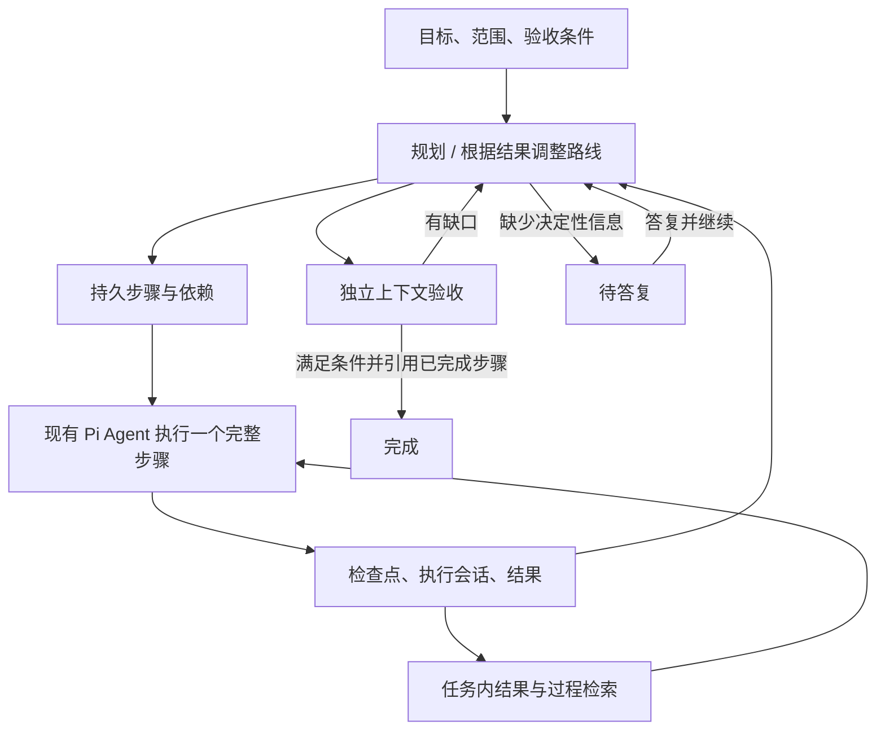

# 统一任务管理

2026-11-13。「任务管理」只有一个列表和一个「新建任务」入口。创建时选择“自主规划”或“按清单执行”：前者根据结果持续调整计划，后者执行用户提供的任务清单并可设置 Cron。原深度测评模块、专属 API、页面、权限及运行引擎已移除；上游 [PR #383](https://github.com/AIPentest/CyberStrikeAI/pull/383) 已关闭。

## 使用

1. 打开「任务管理 → 新建任务」。选择“自主规划”后填写目标、允许范围和验收条件；选择“按清单执行”后每行填写一个子任务。项目、角色、审批和并发设置在同一表单中。
2. 自主规划保存为草稿，手动清单创建为待执行，均需手动开始；若明确选择 Cron，创建后按设定时间自动执行，表单会显示这一行为。
3. 查看持续推进路线、步骤依赖、已观察结果和任务动态。每个步骤关联一个可打开的执行会话，沿用现有过程详情、工具监控、Pi 会话与项目事实。
4. 运行中可提交补充方向，下一轮规划会使用。需要用户信息时，任务进入「待答复」；答复后尝试恢复，恢复失败会明确显示原因，已保存答复不会丢失。
5. 暂停后等到收尾完成再续跑。失败、中断、受阻步骤可明确重试；已完成步骤不重新执行。原执行会话继续保留。重试之前应检查前一次是否已经产生效果。
6. 时间或规划轮数耗尽会保留结果，并显示「预算耗尽」。调整预算后可继续。完成报告也可以在受阻、暂停状态下载，报告保留真实状态和缺口。

例：目标为「整理已提供的本地安全测试材料，形成可交付报告」，范围列出允许读取的文件、输出目录以及“不访问新的目标”，验收条件列出需要包含的证据、覆盖缺口、文件格式及检查方式。不要把目标只写成“深度测评”，应描述希望交付什么。

旧任务、清单、Cron 和执行会话直接出现在统一列表中；清单详情嵌入同一工作区，保留单条执行、编辑、添加、重跑与定时设置。界面按状态和执行方式统一搜索、排序、分页。左右列表均默认 20 条/页，采用与漏洞管理一致的紧凑行与详情抽屉；自动刷新保留页码、选中项和滚动位置。底层保留两种执行器及原 API，不重写已有数据。

## 执行机制

- 控制器调度完整 Agent 运行；工具循环、Skills、上下文压缩、MCP、Tool Guard、HITL 和进程清理复用现有能力。
- 每个步骤独立会话；用户目标、路线、全部步骤索引、近期结果和失败方向作为跨轮上下文。`task_checkpoint` 保存阶段观察；`task_memory` 按任务检索结果与执行过程，`task_trace` 分页读取完整记录（保留重试前的尝试）；`task_result` 显式提交步骤结果。
- 就绪步骤不必等待慢 Worker 或慢规划请求。每任务并行 1–4 步，服务同时最多运行 8 个目标任务。一次规划最多新增 8 步，整个任务最多 200 步、200 轮，执行时间最多 7 天；默认 2 并行、40 轮、6 小时。
- 步骤依赖缺失、环路、重复 ID、相同指令重复派发、修改已完成/运行中步骤均由程序拒绝。失效的未执行或失败路径可退休，原结果保留。
- 状态变更和事件在同一 SQLite 事务提交。领取执行前先落库。服务重启后转为暂停，运行中的步骤转为中断；不会自动重放结果不明的工具。
- 每次启动/继续使用实际操作者；创建和启动分离。执行前及工具调用时复查任务与项目权限；复用现有工具审批。Cookie 写请求校验来源，写入体限制 64 KiB。恢复不借用任务所有者的更高权限。
- 模型请求遇到限流或临时网络故障最多退避重试两次；结构化输出最多修复两次，共用三次请求上限，不自动重放工具。页面轮询不调用模型。等待用户时不占 Worker；失败、暂停、时间/轮数耗尽均不视为成功。步骤成功先要求真实成功工具回执或从其他已完成步骤检索到的证据，检查点自述不计作凭据。完成还要求独立验收通过，引用已完成且有执行会话与结果的步骤，并且不存在未解决步骤。

## GitHub 调研与取舍

调研时间：2026-11-13。以下为源码/文档核对后的设计取舍，不是这些项目的性能排名或漏洞发现能力对标。未运行外部项目的攻击任务，也未将它们的实现复制进本仓库。

| 项目和核对来源 | 值得吸收的机制 | 本次选择 |
| --- | --- | --- |
| [ARTEX](https://github.com/RuoJi6/ARTEX/blob/73d5437c5a64559ed803bcd096d2a0a0014a1214/README.md)、[planner.go](https://github.com/RuoJi6/ARTEX/blob/73d5437c5a64559ed803bcd096d2a0a0014a1214/agent/planner.go) | 事件触发规划；有边界的意图；共享待办；Worker 过程互查；资产与探索分开 | 结果触发再规划、持久步骤依赖、任务内过程检索；项目资产/事实继续使用 CSAI 现有能力。注意 ARTEX 的 `todos` 是进程内共享 map，不能由“跨唤醒共享”推断它本身就可跨进程恢复；本次步骤与路线直接落 SQLite。 |
| [PentAGI flow execution](https://github.com/pentagi-oss/pentagi/blob/90d1f962c0839c14ed10752e93199ee97b281b73/backend/docs/flow_execution.md)、[监督机制](https://github.com/pentagi-oss/pentagi/blob/90d1f962c0839c14ed10752e93199ee97b281b73/README.md) | 持久 Flow/Task/Subtask；生成、执行、修订；结果驱动改变方案；工具与轮数上限 | 目标/步骤分层、失败路线保留与替换、有限并发和停止条件。没有为每一步再叠加多个全职监督 Agent；其文档也指出监督会增加时间与 Token 消耗，收益须独立测量。 |
| [OpenHands GoalController](https://github.com/OpenHands/software-agent-sdk/blob/02e092c0df46dd58d1e46768705c2dfbac05713a/openhands-sdk/openhands/sdk/conversation/goal/controller.py)、[服务恢复](https://github.com/OpenHands/software-agent-sdk/blob/02e092c0df46dd58d1e46768705c2dfbac05713a/openhands-agent-server/openhands/agent_server/event_service.py) | 单次运行结束后审查目标；complete/capped/interrupted 分开；恢复保留未匹配动作的不确定性 | 验收缺口进入下一轮；预算耗尽、执行中断不报成功；工具结果不明确时不自动重放。 |
| [LangGraph checkpoints](https://docs.langchain.com/oss/python/langgraph/checkpointers) | 按步骤保存状态；恢复已有结果；区分中断恢复与历史重放 | 在现有 SQLite 中实现事务检查点与事件，不另引入 Python 或外部编排服务。 |
| [Strix AgentCoordinator](https://github.com/usestrix/strix/blob/main/strix/core/agents.py)、[生命周期工具](https://github.com/usestrix/strix/blob/main/strix/agents/factory.py) | 任务有明确的等待、唤醒与结束语义；不能把任意自然语言回复当成执行终态 | 使用显式 `task_result`；规划问答独立持久保存；取消后等待资源收尾，避免 UI 先宣布完成。 |
| [Anthropic autonomous-coding demo](https://github.com/anthropics/claude-quickstarts/blob/main/autonomous-coding/README.md) | 新会话根据持久进度接续；小步推进；验收清单与执行分离 | 每步骤独立上下文、任务目标/验收条件长期保留、检查点用于后续工作。不采用示例的固定 200 项清单或无上限运行默认值。 |

综合判断：长程能力来自持续修订的任务状态、可检索的观察和可靠续跑。增加角色数量、延长单次聊天上下文或扩大轮数，只是资源设置，无法独自保证目标完成。

## API

使用现有 `tasks:read/write/delete` 权限。统一列表分别检查 `long_task` 和 `batch_task` 资源范围，再合并、筛选与分页；相同 ID 的不同资源不会互相继承授权。原有单任务接口继续检查自身资源范围。

| 接口 | 用途 |
| --- | --- |
| `GET /api/tasks?mode=&status=&q=&limit=20&offset=0` | 统一列表；mode 可为 goal/list，包含旧任务及清单，摘要不包含执行轨迹 |
| `GET /api/batch-tasks/{queueId}?task_page=1&task_page_size=20` | 清单分页预览，附带全清单状态统计；不带分页参数时保留原完整响应 |
| `GET /api/batch-tasks/{queueId}/tasks/{taskId}` | 读取所属清单内单条任务的完整内容与结果 |
| `GET /api/long-tasks/options` | 可用项目、角色与模型渠道，不返回密钥 |
| `GET /api/long-tasks?status=&q=&limit=30&offset=0` | 分页列表；摘要不携带完整目标材料或执行轨迹 |
| `POST /api/long-tasks` | 保存草稿；字段见任务创建表单 |
| `GET /api/long-tasks/{id}` | 当前任务、计划、结果与 revision |
| `POST /api/long-tasks/{id}/control/{action}` | start/pause/cancel/guidance/answer/retry/budget；需要当前 revision，冲突返回 409 |
| `GET /api/long-tasks/{id}/events?after=0` | 事件游标，单页最多 100 条且有字节上限 |
| `GET /api/long-tasks/{id}/report` | Markdown 阶段报告 |
| `DELETE /api/long-tasks/{id}` | 删除非活动任务及事件，保留执行会话 |

答复接口接受 `message`；重试接受 `step_id`；预算调整接受 `max_rounds` 和 `remaining_seconds`。`answer` 返回 `start_error` 时，答案已保存，但任务没有启动。

## 升级与验证边界

升级不删除旧数据库中的深度测评历史表、不执行旧任务，也不自动迁移它们为新目标任务。旧模块源代码、路由和 UI 已移除。若需查询旧数据，可使用升级前版本/备份；不要对运行数据库直接执行删除。原 PR 中与该模块无关的资产归属、工具授权等通用修复继续保留。

本次本地确定性回归检验调度、持久化、取消、恢复、验收和 UI 行为；真实模型的规划质量、真实目标上的持续运行收益与成本仍需要同一批任务的对照试验。独立验收是另一个模型上下文，对步骤证据的判断仍可能出错；不等于人工复测。时间和规划轮数是本实现的硬预算，不提供跨全部模型请求的精确 Token 硬上限。当前为单服务进程设计，不支持多个服务实例同时调度同一数据库。

建议固定 5 类回放任务作为后续版本基线：12 阶段依赖链、失败分支换路、慢 Worker 下推进其他工作、服务中断恢复、验收发现缺口后补齐。再在同模型、同工具、同范围的实际授权任务上比较完成率、重复操作率、人工介入次数、Token 与时间。仅构建或模拟测试通过不能证明长程任务质量已优于 ARTEX。

### 本次实际验证

- 原有全量回归之外，增加统一列表的跨资源权限隔离、合并后分页、混合失败及 Cron 状态保留测试；浏览器检查从真实入口覆盖两种创建方式和详情切换。
- 新增任务控制器与 HTTP/真实 Pi Worker 集成回归：依赖链、慢规划/慢 Worker、失败路径替换、验收补做、时间/轮数预算、暂停恢复、事务失败不启动、权限/来源/版本冲突、任务记忆隔离与长输出尾部检索。
- 真实 Pi SDK 对接本地模拟模型与工具，验证工具—检查点—记忆—结果—验收闭环，以及工具失败后模型虚报成功被拒绝。这里的“真实 Pi”不代表使用了真实供应商模型。
- 真实前端的离线 Playwright 测试覆盖鉴权请求、草稿创建不执行、控制操作、报告下载、轮询保留输入、XSS 转义、明暗主题及 390/1440px 布局。夹具不操作任何现有任务或目标。

- 大清单浏览回归使用 365 条隔离样例，覆盖 20 条/页、19 页末页、双栏滚动、刷新期间手动滚动、详情读取完整结果，以及编辑草稿不被刷新覆盖。
