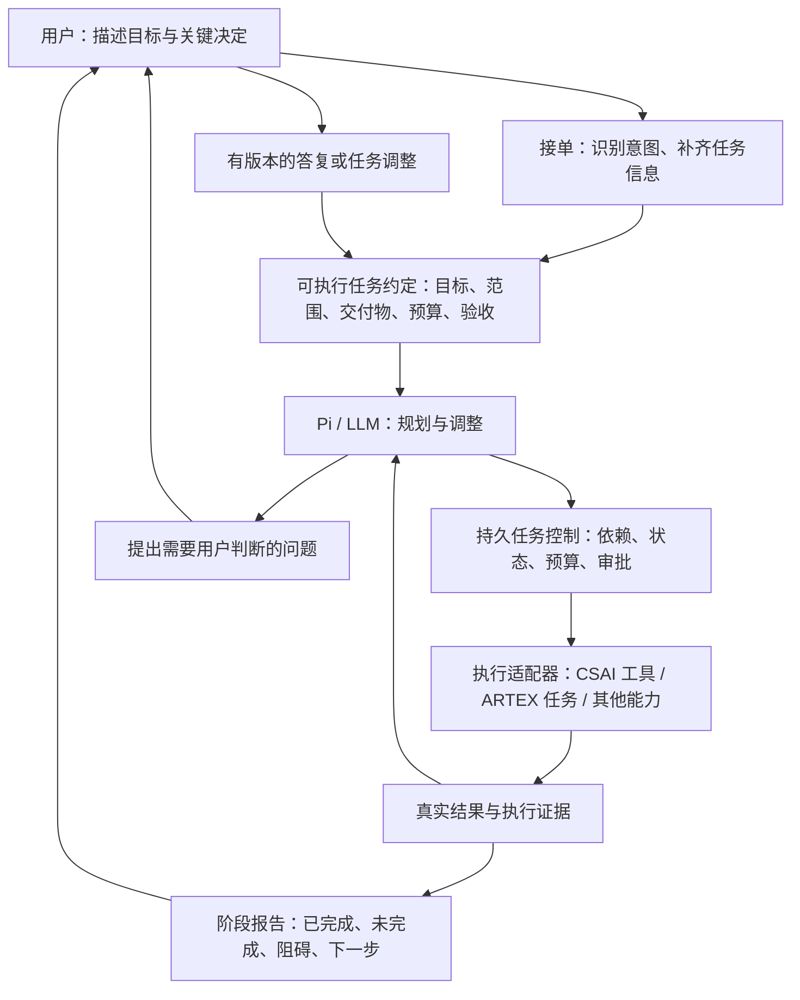

# 任务委派、阶段汇报与主动请示

状态：2026-11-11，首阶段闭环已实现：自然语言接单、意图澄清、自主执行、阶段报告、主动请示与答复续跑。使用方法和当前边界见 [任务委派](task-delegation.md)。本文保留完整设计背景；ARTEX 统一适配器尚未实现。

## 结论

建议把现有深度评估工作台扩展为“交代工作 → 理解任务 → 自主执行 → 阶段汇报 → 必要时请示 → 验收”的任务系统。用户决定目标和关键取舍，LLM 负责理解、规划和选择行动，CSAI／ARTEX 等提供执行能力，后台持久化任务状态与证据。

不必再建立一套与 assessment 并行的长期任务引擎。新增重点是任务接单、问题与答复、阶段报告，以及统一执行适配器。这是结合当前源码作出的设计判断。



模型推理、执行工具与可恢复会话分别管理，是当前实现能够延伸到此模式的基础。Anthropic 的架构文章也将模型执行循环、执行环境和持久会话分开，但本文的具体实现建议沿用本项目的 Pi 与 Go 服务。[架构参考](https://www.anthropic.com/research/managed-agents)

## 已有能力与实际缺口

| 环节 | 当前源码中的能力 | 下一步要补充的行为 |
|---|---|---|
| 交代工作 | `assessment.Task` 有 Goal、Scope、Material、Criteria 与预算，创建时要求关键字段齐全 | 允许先提交模糊自然语言，形成未启动的任务草稿 |
| 规划执行 | Planner、Worker、依赖 DAG、专业角色、暂停／恢复、补充方向 | 将“信息不足，需要问用户”变成正常状态，而非普通失败 |
| 工作记忆 | 任务持久化、执行 ID、证据与有界记忆读取 | 保存当前任务约定的版本、尚未确认的假设与未回答的问题 |
| 阶段汇报 | 增量事件、步骤结果、Markdown 报告及验收复核 | 主动产生面向用户的阶段报告，并突出需要作出的决定 |
| 人工介入 | 工具审批、预算调整和 steer | 区分澄清问题、业务取舍与工具审批，支持有针对性的答复和续跑 |
| 工具使用 | Pi、Go 工具网关、MCP、角色和审批 | 给 ARTEX 等长任务提供一致的提交、状态、事件、取消和产物契约 |

依据：`internal/assessment/types.go`、`engine.go`、`runtime.go`、`worker.go`、`memory.go`、`report.go`、`review.go`、`metrics.go`，以及 `internal/handler/assessment.go`。

## 分词器的位置

需要分开三个问题：

1. **Token 计数与上下文预算**：控制一次模型请求装入多少内容。
2. **文本分词与能力检索**：从工具、技能和项目名称中找候选项。Pi 1.5.2 的 `tool_search` 已使用 Unicode 分词（非 ASCII 使用 `Intl.Segmenter`）和 BM25；此次迁移已接入按需加载工具。
3. **任务意图与缺失信息判断**：理解“帮我看看”“弄好一点”“做到能交付”究竟意味着什么，需要模型生成结构化解释，再由确定性规则核对目标、范围、预算和验收条件。

因此无需把另一个中文分词器作为任务理解的核心。先复用已有分词／检索，在接单层增加结构化意图提取；只有评测证明领域词匹配有明显缺口时，再补充术语词典或专门分词器。[Pi 工具检索源码](https://github.com/earendil-works/pi/blob/v1.5.2/packages/coding-agent/src/extensions/tool-search/tool.ts)

## 任务约定与接单过程

建议增加一个允许字段不完整的 `IntakeDraft`。它完成澄清后才创建现有 `assessment.Task`，避免破坏目前 Task.Validate 对执行必需信息的要求。

```json
{
  "intent": "perform_work",
  "goal": "用户希望达到的结果",
  "deliverables": ["可交付成果"],
  "project_id": "已解析的项目 ID，尚未确定时为空",
  "scope": {"included": [], "excluded": []},
  "constraints": [],
  "acceptance_criteria": [],
  "budget": {"tokens": null, "deadline": null, "timezone": "Asia/Shanghai"},
  "assumptions": [],
  "missing_fields": [],
  "next_action": "ask_owner",
  "revision": 1
}
```

接单模型只做理解和提案，不绑定实际执行工具。系统根据现有项目、角色与已确认上下文填入可靠信息；模型推测进入 assumptions，不能伪装成用户要求。自然语言中的否定条件、排除项和用户更正要保留来源。

确定性规则负责验证必需字段、项目归属、工具可用性、范围和预算。模型输出一个“高置信度”数字，不足以替代这些检查。明确的信息沿用，缺失但不影响当前步骤的信息可以稍后问；阻碍正确执行或涉及关键取舍的信息必须先问。知识问答、解释和状态查询不应自动变成长期执行任务。

## 何时员工自己做，何时问老板

| 情况 | 建议行为 |
|---|---|
| 目标、范围与验收已明确，下一步是常规执行 | 自主执行并记录证据 |
| 缺少可从现有材料可靠读取的信息 | 先查材料，避免重复向用户索取 |
| 项目或目标存在多种合理解释 | 给出简短选项和影响，等待用户选择 |
| 成本、时限、质量或覆盖范围需要取舍 | 说明当前结果、选项和推荐，等待决定 |
| 工具需要人工批准 | 使用既有 HITL，批准只对应具体调用及参数 |
| 一条路径受阻，但存在已允许的替代方法 | 在预算内尝试并说明调整 |
| 继续需要扩大范围或改变已确认约束 | 提交任务约定的变更请求 |
| 只有某个子步骤依赖答复 | 暂停该依赖分支，其余独立工作可继续 |

问题应具体。例如“目前已完成接口清单核对；A 系统缺少测试账号。可以先做公开接口检查，或者等待账号后再覆盖登录功能。我建议先做前者。”要比“是否继续？”更能支持决策。

## 主动请示的持久协议

建议新增原生元工具 `ask_owner`，返回和保存以下对象：

- `question_id`、`task_id`、`step_id`、`task_revision`。
- `kind`：`clarification`、`decision` 或 `approval`；approval 仍委托既有 HITL。
- 问题、提出原因、有限的选项、推荐与各选项影响。
- `blocked_step_ids`、是否存在可继续的独立工作。
- `status`、答复者、答复内容与时间。

问答通过站内任务界面完成。提出问题后持久化状态并结束当前推理调用，不保持一个长时间空等的模型请求。用户回答时校验问题 ID、任务版本和访问权限，重复答复保持幂等；过期答复返回冲突并展示当前问题。答复只恢复对应的依赖分支。服务重启、模型切换和上下文压缩不能丢失未回答的问题。

建议状态：`understanding → awaiting_input → planned → running → awaiting_decision → running → reviewing → completed/partial`。这些状态由后台事件和校验规则推进，模型提出状态变更建议，不直接覆盖任务事实。

## 阶段回报

触发点优先采用完成一个里程碑、获得重要新证据、出现影响计划的阻碍、需要用户决定或预算接近耗尽。普通工具输出继续进入过程记录；用户没有要求周期通知时，不按每次调用反复打断。

每次阶段报告固定回答：

- 已完成什么，以及对应步骤／证据。
- 还有什么未完成，原因是什么。
- 当前有什么阻碍或不确定性。
- 下一步准备做什么。
- 哪一项需要用户决定。

报告先从持久任务与证据记录生成结构化事实，再交给模型组织语言。宣称完成的步骤和执行 ID 必须真实存在；用户意图、模型假设、工具尝试与已验证结果分别标识。没有可计算的进度基准时展示完成项数和剩余项，不伪造百分比。最终交付继续经过现有 Review，而不是把某次阶段报告当作任务完成。

## CSAI 与 ARTEX 的位置

统一执行适配器建议提供：`describe_capabilities`、`submit`、`get_status`、`read_events`、`cancel`、`list_artifacts`。执行请求携带任务及步骤 ID、幂等键、范围、预算、允许能力和验收要求，长操作返回 job ID。主任务控制器负责等待和汇总，不让两个编排器同时主导同一任务。

CSAI 可以直接复用当前 Go/MCP 执行链。ARTEX 若本身已经自主编排，应作为有边界的委派任务接入，保留它的执行与取消语义。本文尚未核对当前 ARTEX 的 API、鉴权和取消契约，因此这些接口是适配器目标，不是对 ARTEX 现有端点的断言。

## 建议实施顺序与验收

1. **自然语言接单**：IntakeDraft、任务约定、缺失字段判断，复用项目选择和现有 Task.Validate。先验证模糊目标、同名项目、否定指令、用户改口和纯问答。
2. **主动请示与阶段报告**：问题对象、答复 API、等待／恢复状态、里程碑报告。验证重启、重复答复、过期问题和多个子步骤同时等待。
3. **统一执行适配器**：先封装 CSAI，再核对 ARTEX 后增加适配；验证取消传播、重复提交和部分完成。
4. **固定评测集**：在现有 assessment 指标与 `scripts/assessment-evaluate.py` 上增加意图字段正确率、必要问题漏问率、不必要提问次数、报告事实一致性、答复后正确恢复率及成本／延迟。

首个可交付闭环应是：用户说一句模糊任务，系统提出必要的一两个问题，生成可执行约定；执行一个阶段后如实汇报，遇到需要用户判断的分支时提出具体问题，得到答复后从原进度继续。先把这一条链路验证稳定，再扩大到更多工具平台。

框架本身不替代业务判断。Pi 的会话、事件、steering 与扩展能力适合承载此流程；确定的状态转换、预算和执行证据仍由后台控制。[Pi SDK](https://github.com/earendil-works/pi/blob/v1.5.2/packages/coding-agent/docs/sdk.md)；[工作流与 Agent 的组合原则](https://www.anthropic.com/research/building-effective-agents)。
